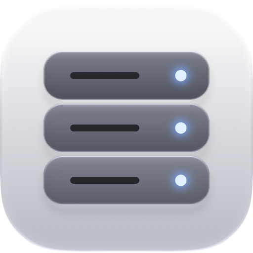

<p align="center"></p>

# mcpock

<p align="center">
  <a href="#install"></a>
  <a href="docs/DEVELOPING.md"></a>
  <a href="#install"></a>
  <a href="#connect-an-agent"></a>
  <a href="docs/THIRD-PARTY.md"></a>
  <a href="docs/release-notes/1.18.0.md"></a>
  <a href="LICENSE"></a>
</p>

<p align="center"><a href="https://mcpock.com">mcpock.com</a> · <a href="https://github.com/aka-kika/mcpock/releases/latest">latest release</a></p>

A native macOS menu bar app that checks every MCP server your AI agents use and tells you which ones are broken, slow, waiting for a sign-in, or set up differently from one agent to the next. MCP (Model Context Protocol) servers are the small programs that give agents like Claude Code, Cursor or Codex their extra tools. mcpock knows where 18 agents keep their servers, finds them, starts each one the way the agent would, and checks that it answers. You can turn a server or a single tool off per agent from one place; mcpock changes a config only when you flip a switch, and shows you the change first.

![mcpock's panel in dark mode (made-up demo servers). Left, the Agents tab: three outlined tiles on top (14 servers in use, 3 of 30 tools turned off, 4 need you), then one line per agent with how many of its servers are on, and the Cursor agent open with its three servers. Middle, the card of the broken postgres server with its error, Ask an agent and Copy errors. Right, the Servers tab: the four servers that need you first, each with its icon and a small state mark, then all servers with their tool counts ("6/8 tools").](docs/images/mcpock-hero-dark.png)

- macOS 26 or later, Apple Silicon. Lives in the menu bar only: no Dock icon, no window.
- Swift and SwiftUI, one dependency (Sparkle, for signed updates).
- Reads Claude Code, Claude Desktop, Cursor, Windsurf, Codex, Grok, Goose, Hermes, OpenCode, VS Code and more, plus any standard MCP config it finds.
- Ships its own small MCP server, so you can say "check my mcpock" to an agent.

## Problems first, in plain words

When you use more than one agent, the same MCP server ends up in several config files, each written a little differently. One day a tool quietly stops working in one agent and not the others, and the agent rarely says why. mcpock gives you one place to look.

It starts each local server (or calls a remote one), does the MCP handshake, asks for its tool list, then stops it. It does this every 15 minutes by default (1 minute to 4 hours, or only when you click Refresh), and checks a server again within seconds when you save its config.

Three tiles sit on top of both tabs: **Servers in use**, **Tools turned off** (how many of all, "149/388") and **Need you** (a quiet 0 with "all fine" when nothing does). On the **Servers** tab every server has its own icon: a mono mark for well-known servers, mcpock's plain server mark for the rest. A server that is fine shows the icon alone. Any other state is a small mark on the icon's corner, a shape and not only a colour:

| Mark on the icon | Means |
|------------------|-------|
| None | Fine: it started and listed its tools |
| Ring (amber) | Slow (no answer in 20 s, tried twice; 10 s for a remote server) or needs sign-in (HTTP 401/403) |
| Ring (grey) | Still checking |
| Diamond (red) | Broken: could not start, quit on start, or refused the handshake |
| Dash (grey) | Turned off or paused by you, runs inside its own app, signed in by the agent, a `${VAR}` it cannot fill, or its Mac app is closed |

**Your own server icons:** to give any server your own picture, put a file named like the server (`my-server.svg`, `.pdf` or `.png`) in `~/Library/Application Support/mcpock/ServerIcons/`. mcpock draws it in one colour, in place of its own pick. The files stay on your Mac.

Each row ends in one value: "7 tools", or "5/7 tools" when some are turned off, or "No tools" for a broken server that never listed any. The list starts with *Needs you*, then your pinned servers, then *All servers*; the ones you turned off everywhere fold away at the end. Click a row for its card: the full error with **Copy errors** and **Ask an agent**, which agents use the server and where their configs live, its tools, and **Check again**, **Pin** and **Hide**. The menu bar icon stays plain while all is fine; no numbers, no blinking, no notifications. Control-Option-M opens the panel from any app, and the arrow keys, Return, Cmd-F and Cmd-R work as you would expect.

## One line per agent

![mcpock in light mode (made-up demo servers), three views side by side. The Agents tab: the three tiles, then seven agents, each with its logo, a ring or diamond when one of its servers needs you, and a count such as "2/3 servers". The Servers tab with the four servers that need you and their reasons. The Agents tab scrolled down: the Claude account section with three connectors (one not answering, one off in a project, one fine with "41 calls") and the Managed online section with Grok web, ChatGPT and Cursor cloud.](docs/images/mcpock-tabs-light.png)

The panel opens on the **Agents** tab: one line per agent, the ones that need you first, each saying how many of its servers are on ("21/29 servers"). Open one to see its servers and its config file. Turn on **Usage counts** in Settings > General to see how many times each agent called its servers in the last 30 days, on the open agent's first line, and each tool's calls on a server's card (read from Claude Code, Grok, Cursor and Hermes history on your Mac; off until you turn it on).

Two more sections follow the agents, for servers that are not in a file on your Mac:

- **Claude account:** the claude.ai connectors of your account, as Claude Code lists them: connected, not answering, needs sign-in, or off in a project, and with Usage counts on, how many times Claude Code called each. Off until you turn on **Include claude.ai connectors** in Settings > Agents, because mcpock has to ask Claude Code, and Claude Code starts its servers to answer. It asks at most every 30 minutes.
- **Managed online:** Grok web, ChatGPT, Cursor cloud and Gemini keep their servers on their own sites, where mcpock can't check them. Each gets a row that opens its page; type their server names in Settings > Agents if you want them listed.


Desktop widgets show the same at a glance: **Status** (small), **Problems** (medium) and **Agents** (small and medium). Right-click the desktop, **Edit Widgets…**, and search for mcpock.

## Set up differently, side by side

When one agent launches a different command or address for the same server than the others (often an old path), the row says so, and **Compare** on the card shows each agent's version side by side, with secret values hidden. The same runtime in another folder is not a difference. If the agents are meant to differ, choose **Mark as intended**; the note comes back by itself if an agent's setup changes later.

When a server drops inside a Claude Code session that is still open, its row says "Lost in 1 open Claude Code session: run /mcp there", even while mcpock's own check reaches it.

## You flip the switches


A switch beside each agent on a server's card turns that server on or off there, and a switch beside each tool hides that tool from your agents. mcpock uses each agent's own setting where it has one (Claude Code's blocked and deny lists, `enabled` and `disabled_tools` lines in Codex, Grok, Goose, Hermes and OpenCode, `disabled` in Cline), shows you the change first and saves a backup of the file. Claude Desktop, Cursor, VS Code and Windsurf have no off setting, so a server you turn off there waits in mcpock's own folder and moves back when you turn it on. Nothing is deleted, and one click turns it back.

Agents can't flip a switch. They can only ask: an ask shows on the server's card with its reason and Yes and No, and only your Yes changes anything, through the same sheet. Everything else mcpock does only reads.

## Hide single tools where the agent can't


Cursor, Claude Desktop, VS Code, Cline and Windsurf have no setting for hiding one tool of a server. For those, a server's card offers mcpock's **filter**: press **Set up**, read the change, confirm. That agent then starts mcpock's small helper, the helper starts the server and leaves out the tools you turn off. The server's own command, arguments and keys stay in the entry, word for word, and **Remove** on the card puts the entry back as it was.

The filter is for servers that run as a command. Its entry holds the path of mcpock.app, so remove the filter before you move or delete mcpock; until then that agent can't start the server, and mcpock shows it as broken and says why.

## Connect an agent

mcpock includes `mcpock-mcp`, a small MCP server that only reads the status file mcpock writes after each check. In this role it never starts a server and never changes a config. (The same helper is what the tool filter starts, in a separate mode, for an agent you set the filter up for.)

**The easy way:** Settings > **Connect** > **Copy for Claude**, then paste into Claude Code. **By hand:** Settings > Connect shows which agents already have mcpock, with the right line for each. For Claude Code:

```bash
claude mcp add --scope user mcpock -- /Applications/mcpock.app/Contents/Helpers/mcpock-mcp
```

For agents that use `mcpServers` JSON (Claude Desktop, Cursor, Windsurf, Cline and most others):

```json
{
  "mcpServers": {
    "mcpock": {
      "command": "/Applications/mcpock.app/Contents/Helpers/mcpock-mcp",
      "args": []
    }
  }
}
```

Then ask your agent to "check my mcpock". The tools it gets:

| Tool | Answers |
|------|---------|
| `mcpock_status` | Counts: how many servers are fine, broken, slow, need a sign-in or are set up differently, and when mcpock last checked |
| `mcpock_problems` | Every server that needs attention, with the reason, the agents and the config files involved |
| `mcpock_server` | Everything about one server, by name, with each tool's calls and last use (when Usage counts are on) |
| `mcpock_switches` | Which servers are turned off, and in which agents, which tools are hidden, and what became of each ask |
| `mcpock_ask` | Asks you to hide or show a tool, or turn a server off or on, with a reason. Changes nothing by itself |

The first four only read. Secrets are masked. If mcpock isn't running, hasn't checked yet, or its results are old, the answer says so.

## Privacy

- To check a local server, mcpock runs the exact command from your config, the same thing your agent runs, then stops it and its child processes. Paused servers are never started.
- mcpock's own network connections are to the remote MCP servers in your configs and to mcpock.com to check for updates. No accounts, no analytics. With claude.ai connectors turned on, it runs `claude mcp list`, and Claude Code talks to claude.ai as it always does.
- It writes to an agent's config in three cases only, each after showing you the change and saving a backup: a server on or off, a tool hidden or shown, the tool filter set up or removed.
- Anything that looks like an API key is masked wherever mcpock shows or stores it. The status file for agents holds env and header names, never their values.
- Usage counts keep only the agent, the server name and the day: never a message, an argument, a result or a file path.
- Why no App Store: its sandbox would stop mcpock from starting servers and reading configs in your home folder.

Every detail: [docs/PRIVACY.md](docs/PRIVACY.md).

## Install

```bash
brew install --cask aka-kika/tap/mcpock
```

Or download `mcpock.dmg` from [mcpock.com](https://mcpock.com) or the [Releases](https://github.com/aka-kika/mcpock/releases) page, open it and drag **mcpock** to Applications. It is signed and notarized by Apple and updates itself (Sparkle; you are asked before the first automatic check).

Needs macOS 26 or later on Apple Silicon. Launch it and look for its icon in the menu bar. If one of your servers lives in Documents, Desktop or Downloads, macOS asks whether mcpock may open that folder: click **Allow**, since mcpock has to start the server from there. Turn on **Open at Login** in Settings > General if you want it always there.

## Docs

- [docs/SUPPORTED-AGENTS.md](docs/SUPPORTED-AGENTS.md): every agent mcpock reads, its config file and format, and the special cases.
- [docs/PRIVACY.md](docs/PRIVACY.md): what mcpock runs, reads, writes and sends.
- [docs/FAQ.md](docs/FAQ.md): what each state means, what to do about it, and how to uninstall (remove the tool filter first).
- [docs/DEVELOPING.md](docs/DEVELOPING.md): build, test, how it works, adding an agent, release.
- [docs/ARCHITECTURE.md](docs/ARCHITECTURE.md): the module map, one refresh step by step, the rules that must not regress.
- [docs/THIRD-PARTY.md](docs/THIRD-PARTY.md): Sparkle, the agent logos and the server icons, with their licenses.
- [docs/images/1.18/](docs/images/1.18/): every screen in light and dark, as single pictures.
- [docs/release-notes/](docs/release-notes/): what changed in each version.

## Release

Each version's notes are in [docs/release-notes/](docs/release-notes/); the newest is [1.18.0](docs/release-notes/1.18.0.md). Signed and notarized DMGs are on the [Releases](https://github.com/aka-kika/mcpock/releases) page and mcpock.com. How a release is built: [docs/DEVELOPING.md](docs/DEVELOPING.md#release).

## Thanks

mcpock's interface was shaped by studying these open-source Mac apps, found and kept with [reshelf](https://github.com/aka-kika/reshelf), the author's app for collecting repos. Thank you to their authors:

- [RepoBar](https://github.com/steipete/RepoBar) by @steipete: dashboard rows, detail on demand, pinned and hidden in Preferences.
- [Skills Manager](https://github.com/yibie/skills-manager) by @yibie: the "which agent uses what" view and showing set-up-differently states.
- [mectrics](https://github.com/farukkamcici/mectrics) by @farukkamcici: a quiet menu bar icon that only speaks up when something's wrong.
- [cctop](https://github.com/st0012/cctop) by @st0012: sorted by what needs you, keyboard first.
- [AgentBar](https://github.com/michalstrnadel/AgentBar) by @michalstrnadel: real agent marks instead of text.
- [Hop](https://github.com/antonyshakirov/hop) by @antonyshakirov: tabs in a menu bar panel.
- [TokenMon](https://github.com/faulknerpearce/token_monitor) by @faulknerpearce: a section per agent with a small bar.
- [sidelight](https://github.com/50BytesOfJohn/sidelight) by @50BytesOfJohn: small caps section headers and calm stacked cards.
- [agent-hud-open](https://github.com/jazzenchen/agent-hud-open) by @jazzenchen: the stat tile, a small label over one big number.
- [mole-widget](https://github.com/TadelUnso/mole-widget) by @TadelUnso: one summary line and tidy columns in a widget.
- [Orbit](https://github.com/3x-haust/Orbit) by @3x-haust: the one-line notice card with a single button.
- [KyttoMCP](https://github.com/heyitsjakub/KyttoMCP) by @heyitsjakub: a summary of the whole setup on top.
- [agent-widgets](https://github.com/Surdeddd/agent-widgets) by @Surdeddd: rings in desktop widgets.

In-app updates run on [Sparkle](https://sparkle-project.org) (MIT). Agent logos come from [LobeHub Icons](https://github.com/lobehub/lobe-icons) (MIT) and [Simple Icons](https://github.com/simple-icons/simple-icons) (CC0), and the server icons from Simple Icons and Apple's SF Symbols; the logos are trademarks of their owners, and mcpock is not affiliated with or endorsed by any of them. Details: [docs/THIRD-PARTY.md](docs/THIRD-PARTY.md).

## Contributing

Issues and pull requests are welcome. mcpock is small on purpose: read [CONTRIBUTING.md](CONTRIBUTING.md) first.

## License

MIT. See [LICENSE](LICENSE).

---

Made by **Kika** ([aka-kika](https://github.com/aka-kika), [akakika.com](https://akakika.com)).
